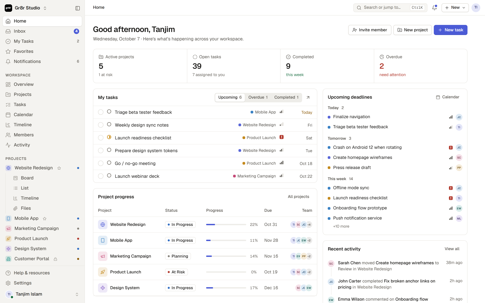

# Gr8r Studio

A calm, structured project management workspace: home dashboard, inbox, my tasks, projects with
board / list / table / calendar / timeline / files views, members, teams, activity and settings.

Built with plain JavaScript ES modules and CSS, bundled by [Vite](https://vite.dev). There is no
UI framework and no runtime dependency. The repository root is a Symfony app (the API, see
[Backend](#backend)); the frontend's sources are in `assets/`, and its build goes into Symfony's
`public/`, so Apache serves both from one directory.



## Getting started

Requires Node.js 22 (`.nvmrc`); `npm test` relies on its glob support in `node --test`.

```bash
npm install
npm run build        # the app in backend mode, into public/ (next to Symfony's index.php)
npm run build:demo   # the localStorage demo, into dist/ (what Vercel deploys)
npm run dev          # http://localhost:5173 with hot reload (optional, for frontend work)
npm run preview      # serve the demo build locally
npm run lint         # ESLint
npm run format       # Prettier
npm test             # unit tests (node --test)
```

### Backend mode

Without `VITE_API_URL` the app is a static demo: the workspace lives in this browser's localStorage
(`npm run build:demo`). With `VITE_API_URL` set at build time it runs against the Symfony backend
at the repository root instead (see [Backend](#backend), and `docs/adr/0002`, `0004`).
`npm run build` sets it to `api`, relative to the page, so the app calls the API next to itself:
under `http://localhost/repos/gr8r-studio/public/` as at a vhost's root.

```bash
npm run build                    # then open http://localhost/repos/gr8r-studio/public/
VITE_API_URL=/api npm run dev    # or put VITE_API_URL=/api in assets/.env.local (git-ignored)
```

The dev server forwards `/api` to the app under Apache (`http://localhost/repos/gr8r-studio/public/api`),
so the session cookie stays on one origin. Sign in as `hello@gr8rstudio.com` with `gr8r-studio-demo`. The app asks `/api/me` at boot
(and shows the login screen without a session), loads the workspace from `/api/bootstrap`, and
every `save()` sends the changed records to `/api/sync` (`assets/src/actions/sync.js`; the synced
collections are listed in `SYNCED` in `assets/src/core/sync-rules.js`, so far the Workspace's name, URL and colour `ws`,
`teams`, `members`, `projects`, `tasks`, the sidebar's `projOrder`, `comments`, `activity`, `files`, the
`read` flag of `notifs`, `events`, `savedViews`, and the Member's own `prefs`, `views`, `notifPrefs` and
`recentSearches`). Uploads (drawer, Files view, task form, drag and drop) send the real file to
`/api/files`, up to 25 MB each; previews and downloads come from the server, and a Task's attachments
are its Files. Preferences and view settings follow the Member to every browser; name and title
are the Member's profile, not Preferences. When the server has none for a Member yet (their first
sign-in in this mode), the ones this browser kept are sent, unless they belonged to another Member.
Teammates' changes come in when the tab regains focus and every 60 s
while it is visible (after pending changes are sent, and not while you are typing in a field or
have a dialog open); an expired session keeps your unsynced changes and sends them once you sign
in again as the same Member. Inviting someone emails them a link (in dev, links from emails are in
`var/log/mail.log`) that opens the app at `#join/<token>`, where they choose a name and a
password and are signed in as the new Member; "Resend invite" in a Member's menu sends a fresh link.
Signing up sends a verification link the same way (`#verify/<token>`); opening it signs the new User
in and continues into onboarding, whose last step creates their own Workspace, with them as its Owner,
and syncs the first Project, its template Tasks and any invites. Until then signing in shows the verify
screen, which sends a new link on request; a User signed in without a Workspace (one who exited setup,
or a removed Member) is taken to onboarding, and exiting it signs out. "Forgot password?" emails a
link to `#reset/<token>`, valid for 30 minutes, whose new password signs in; changing the password
in the settings signs out the User's other sessions. When an Owner deletes the Workspace (settings,
typing its name), they land in onboarding, and everyone else in it does on their next sync or
refresh. Signing in, signing up and the emailed links are rate-limited (a 429 shows its message; see
[Endpoints](#endpoints)). Social sign-in, replaying onboarding, the workspace switcher and the demo reset
are not available in this mode yet.

## Project structure

```
assets/                 the frontend (Vite's root)
  index.html            HTML entry; loads src/main.js
  public/favicon.svg    brand mark, copied into the build
  src/                  the frontend's JavaScript and CSS (below)
public/                 Symfony's web root: index.php, .htaccess, and the build (git-ignored)
bin/ config/ migrations/ src/ tests/
                        the Symfony app (see Backend, "Where things live")
vite.config.js          Vite config, including the Lucide icon-subset plugin
eslint.config.js        lint rules (ESLint flat config); formatting by Prettier (.prettierrc.json)
.github/workflows/      CI: lint, format check, unit tests, both builds; backend PHPUnit
docs/preview.png        README screenshot
assets/src/
  main.js               entry: imports styles and modules, then boots the app
  styles/
    index.css           imports every stylesheet in cascade order
    tokens.css          colours, spacing, type, radius, the shared --gutter
    base.css  components.css  shell.css  panels.css  overlays.css  states.css  motion.css  responsive.css
    views/              list, board, table, calendar, timeline, projects & files
    pages/              settings, auth & onboarding
  core/                 utilities, constants, icons, store (state + lookups), theme,
                        API client and the sync diff (backend mode)
  data/seed.js          demo workspace data
  ui/                   shared render helpers, toasts, the select dropdown
  shell/                render loop and router, sidebar/topbar layout, skeletons, view engine
  components/           task list renderer
  pages/                one module per route
  views/                project views: board, table, calendar, timeline, files, overview
  overlays/             task drawer, modals, popovers, context menu, command palette
  features/             teams, subtasks, archive (rendering)
  actions/              user actions, event wiring, keyboard shortcuts, drag and drop,
                        sync with the backend
```

### Layers

Dependencies point downward:

1. `core/` and `data/` depend on nothing else in the app.
2. `ui/`, `shell/`, `components/`, `pages/`, `views/`, `overlays/` and `features/` render HTML from state.
3. `actions/` change state and re-render. Each action module registers its handlers on the
   shared action table (`A`) when it loads, so `main.js` imports them after `actions/actions.js`.
   In backend mode `actions/sync.js` registers on the store's save hook (`onSave`) the same way,
   so `core/store.js` never imports from a higher layer.

## Conventions

- **Rendering:** each page or view is a function that returns an HTML string from the store
  (`S`). `render()` rebuilds the shell and keeps focus and scroll positions.
- **Interactions:** elements declare `data-a="actionName"`. `actions/events.js` delegates the
  click to `A.actionName`. Inputs use `data-in`, blur handlers use `data-blur`.
- **Layout:** every page edge uses `var(--gutter)`, so the breadcrumb, page header, toolbar,
  list, table and board start on the same line.
- **Dropdowns:** write a normal `<select class="select">`. `ui/select.js` renders it as the
  design-system menu and keeps the native element as the source of truth.
- **Icons:** call `ic('name')` with any [Lucide](https://lucide.dev) icon name. The
  `virtual:icons` plugin bundles only the icons the source uses.

## Continuous integration

Every push and pull request runs lint, the format check, the unit tests and both builds,
and the backend's PHPUnit suite against MariaDB 10.11 (`.github/workflows/ci.yml`).

## Deploy

`vercel.json` builds the demo (`npm run build:demo`) and serves `dist/`.

## Backend

Symfony 8.1 and MariaDB 10.11. The API speaks the frontend's own data shape: `GET /api/bootstrap`
returns the visible Workspace as the frontend's `S.data`, and `POST /api/sync` applies an ordered
batch of writes in one transaction (see `docs/adr/` and `CONTEXT.md`).

Requirements: PHP 8.4 with `pdo_mysql`, Composer 2, a local MariaDB 10.11 with the databases
`gr8r` (dev) and `gr8r_test` (tests) and a user with all rights on both.

### Run it

All commands run in the repository root.

```sh
composer install

# The local MariaDB, in .env.local (dev) and .env.test.local (tests; the database name gets _test
# appended, so gr8r becomes gr8r_test), both git-ignored:
# DATABASE_URL="mysql://<user>:<password>@127.0.0.1:3306/gr8r?serverVersion=10.11.14-MariaDB&charset=utf8mb4"

# Schema (dev)
php bin/console doctrine:migrations:migrate -n

# Demo Workspace "Gr8r Studio", dated relative to today. Re-running replaces it with a fresh copy.
php bin/console app:demo:seed

# The app (frontend build and API) under Apache, see "Under Apache"; no PHP or Vite server needed.
npm run build
```

PHP keeps uploads up to upload_max_filesize (2 MB by default) and drops request bodies over
post_max_size (8 MB): raise both above the 25 MB a File may be (PHP-FPM's php.ini).

Uploaded Files are kept in `var/storage/<Workspace id>/<File id>` (`FILE_STORAGE_DIR` in `.env`;
git-ignored, never under `public/`); the tests use `var/test-storage`, emptied at the start of every run.

The app is `http://localhost/repos/gr8r-studio/public/` (see "Backend mode" above).

Sign in as `hello@gr8rstudio.com` (the Owner) or any other active demo Member, such as
`sarah@gr8rstudio.com`, with the password `gr8r-studio-demo`:

```sh
curl -c cookies.txt -H 'Content-Type: application/json' \
  -d '{"email":"hello@gr8rstudio.com","password":"gr8r-studio-demo"}' http://localhost/repos/gr8r-studio/public/api/login
curl -b cookies.txt http://localhost/repos/gr8r-studio/public/api/bootstrap
```

### Under Apache

`public/.htaccess` serves the built frontend (`public/index.html`) for the directory itself, routes
every other request that isn't a file to `index.php` (the rules the `symfony/apache-pack` recipe
ships) and hands PHP files to PHP 8.4's FPM socket, whatever the vhost's default PHP is. With the
repo served at `http://localhost/repos/gr8r-studio/`:

```bash
npm run build   # the app into public/, calling the API relative to itself (api/…)
# links in emails should open the app: put this in .env.local (git-ignored)
APP_FRONTEND_URL=http://localhost/repos/gr8r-studio/public
```

Then open `http://localhost/repos/gr8r-studio/public/`; no PHP or Vite server is needed. `var/` must be writable by PHP-FPM's
user (cache, sessions, uploaded Files, the mail log).

### Emails

Emails go nowhere (`MAILER_DSN=null://null`). In dev, links from emails are in `var/log/mail.log`:
one line per email with its recipient, subject and links (`src/EventListener/MailLogListener.php`),
so a verification, password reset or Invite link can be opened from there:

```sh
tail -n 1 var/log/mail.log
```

### Tests

PHPUnit runs against the real MariaDB test database (`gr8r_test`); every test runs in a transaction
that is rolled back (dama/doctrine-test-bundle).

```sh
php bin/console doctrine:migrations:migrate --env=test -n
php bin/phpunit
# The test of a File of exactly 25 MB runs only with PHP's upload limits raised; otherwise it is skipped:
php -d upload_max_filesize=30M -d post_max_size=32M bin/phpunit
```

#### Browser tests

Playwright drives the backend-mode app under Apache the way a user does (`e2e/`). They run on their
own database, so they never touch the dev one: `e2e/www/` is a second web root next to `public/`,
with the same `.htaccess` and a front controller (`e2e/www/index.php`) that takes the database, the
file storage and the base of mailed links from `.env.e2e.local`. Links the app mails are read from
`var/log/mail.log`.

```sh
# Once: an empty database gr8r_e2e for the same MariaDB user, and .env.e2e.local (git-ignored):
# DATABASE_URL="mysql://<user>:<password>@127.0.0.1:3306/gr8r_e2e?serverVersion=10.11.14-MariaDB&charset=utf8mb4"
# FILE_STORAGE_DIR=%kernel.project_dir%/var/e2e-storage
# APP_FRONTEND_URL=http://localhost/repos/gr8r-studio/e2e/www

npm run test:e2e   # builds into e2e/www/, migrates and seeds gr8r_e2e, signs in the demo roles, runs e2e/
```

Signed-in sessions are kept in `e2e/.auth/` (git-ignored, live cookies). The browser is the cached
Chromium that `@playwright/test` 1.61.1 expects.

### Endpoints

| Endpoint                           | Purpose                                                                                                                                                                                                                                                                                                                   |
| ---------------------------------- | ------------------------------------------------------------------------------------------------------------------------------------------------------------------------------------------------------------------------------------------------------------------------------------------------------------------------- |
| `GET /api/health`                  | `{"status":"ok"}`, no sign-in needed                                                                                                                                                                                                                                                                                      |
| `POST /api/login`                  | `{email, password}` → `{user:{email,name}, member}` + session cookie                                                                                                                                                                                                                                                      |
| `POST /api/signup`                 | no sign-in needed: `{name, email, password}` → `202`, also for an address that has an account (its owner is emailed that instead), so the answer tells nothing; emails a link `<APP_FRONTEND_URL>/#verify/<token>`; `422 invalid` (weak password, missing name, no email address)                                         |
| `POST /api/verify-email`           | no sign-in needed: `{token}` → same body as login with `member: null` + session cookie; `404 not_found` (unknown, used or replaced link), `410 expired` (after 24 hours)                                                                                                                                                  |
| `POST /api/verify-email/resend`    | no sign-in needed: `{email}` → `202` always; emails a new link (the old one stops working) only when the address has an unverified User                                                                                                                                                                                   |
| `POST /api/password/forgot`        | no sign-in needed: `{email}` → `204` always; emails a link `<APP_FRONTEND_URL>/#reset/<token>` (valid 30 minutes, replaces an earlier one) only when the address has a User                                                                                                                                               |
| `POST /api/password/reset`         | no sign-in needed: `{token, password}` → same body as login + session cookie; the User counts as verified, their other sessions end; `422 invalid` (weak password: the link keeps working), `404 not_found` (unknown, used or replaced link), `410 expired`                                                               |
| `POST /api/workspaces`             | a signed-in User without a Workspace: `{name, url, c}` → `201`, same body as login with their new Owner Member; `422 invalid` (URL taken or no slug, colour), `409 conflict` (a Member of a Workspace already)                                                                                                            |
| `DELETE /api/workspace`            | Owners: `{name}` (the Workspace's name, exactly) → `204`; deletes everything in it and its Files' content; its Members' Users stay without a Workspace (`403 no_workspace`); `422 invalid` (another name), `403 forbidden` (not an Owner)                                                                                 |
| `POST /api/logout`                 | `204`, ends the session                                                                                                                                                                                                                                                                                                   |
| `GET /api/me`                      | same body as login, or `401`; `403 no_workspace` when the User is no Member (any more)                                                                                                                                                                                                                                    |
| `POST /api/me/password`            | `{current, new}` → `204`; this session stays signed in, the User's other sessions end and an open reset link stops working; `401 invalid_credentials` (wrong current password), `422 invalid` (weak new one)                                                                                                              |
| `GET /api/bootstrap`               | `{data, prefs, views}` for the signed-in Member; `403 no_workspace` as for `/api/me`                                                                                                                                                                                                                                      |
| `POST /api/sync`                   | `{"ops": [{op, type, id?, data?}]}` → `{"ok": true}`, `422` or `403`                                                                                                                                                                                                                                                      |
| `GET /api/invites/{token}`         | no sign-in needed: `{email, name, workspace, account}` of an open Invite; `account` says the address has a User already; `404 not_found`, `410 expired`                                                                                                                                                                   |
| `POST /api/invites/{token}/accept` | no sign-in needed: `{name, password}` → same body as login + session cookie; `404 not_found` (unknown, used or replaced link), `410 expired`, `422 invalid` (weak password), `401 invalid_credentials` (the address has a User and this is not its password), `409 conflict` (that User is a Member of another Workspace) |
| `POST /api/members/{id}/invite`    | Owners and Admins send an invited Member's Invite again: `204`; `403`, `404`, `422` for a Member who joined                                                                                                                                                                                                               |
| `POST /api/files`                  | multipart `file`, `id`, `project`, optional `task` → `201` with the File record (`type`, `size`, `by` and `at` are the server's); `422` for more than 25 MB, an id in use or a Task of another Project; `403` for Guests and Private projects one is not in                                                               |
| `GET /api/files/{id}/content`      | the File's content with its name (`Content-Disposition: attachment`), its type by extension, `nosniff` and a sandboxing CSP; `404` for a File one doesn't see, as for one that doesn't exist                                                                                                                              |
| `POST /api/files/{id}/copy`        | `{id}` → `201` with a copy of the File, content included, named like the frontend's Duplicate (`notes copy.txt`); `404`, `403`, `422` as for an upload                                                                                                                                                                    |

Errors answer as `{"error": "<code>", "message": "…"}`; without a session every endpoint except
health, login, signup, the two `/api/verify-email` ones, the two `/api/password` ones and the two
`/api/invites/{token}` ones answers `401 {"error":"unauthenticated"}`. Signing in with the right
password before verifying the address is `403 {"error":"unverified"}`; a wrong one stays
`401 invalid_credentials`.

Rate limits (`src/Security/RateLimits.php`, limits in `config/packages/rate_limiter.yaml`): past one,
the request answers `429 {"error":"too_many_requests"}` with `Retry-After` in seconds, before any
password is checked. Signing in: 5 attempts a minute per email address and IP (a successful sign-in
starts over); emails to one address (signup, a new verification link, a reset link, an Invite sent
again): 3 a quarter hour; accepting one Invite link: 5 a minute; and every one of these endpoints, also
verify-email, password reset and change: 20 a minute per IP. The dev environment allows 50 emails per
address and 1000 requests per IP, so the browser checks, which all come from 127.0.0.1, fit; the
sign-in limit is the same. The counts live in the `cache.rate_limiter` pool (the filesystem cache):
`php bin/console cache:pool:clear cache.rate_limiter` starts them over; reseeding does not. Behind a
reverse proxy, configure `trusted_proxies`, or every client counts as the proxy's IP.

### Where things live

- `src/Snapshot/Snapshot.php`: what a Member sees of their Workspace, in the frontend's shape.
- `src/Sync/Sync.php`: applies a batch in one transaction. One handler per collection or singleton
  in `src/Sync/Handler/`; a new synced collection (`put`/`delete`) is one new class implementing
  `App\Sync\CollectionHandler`, a new singleton (`set`, like `projOrder`) one implementing
  `App\Sync\SingletonHandler`. When a new Task brings a key already taken in its Project, the
  server renumbers it and the answer says so: `{"ok": true, "keys": {"<taskId>": "WEB-207"}}`.
- `src/Sync/Handler/CommentHandler.php`: a new Comment is the signed-in Member's whatever the
  client sends; on someone else's Comment a Member may only add or remove their own id in the
  Reactions (`re`), and only the author deletes it, as long as they see its Task. Anyone who sees the Task may comment, Guests
  included. Deleting a Task or a Project deletes its Comments. A deleted Comment leaves a
  `DeletedComment` behind (never in bootstrap): when undo puts the same id again, the Comment comes
  back as its author's, for a Member who sees its Task, instead of becoming a new one by whoever undid.
- `src/Sync/Handler/ActivityHandler.php`: Activity is append-only. A new entry is the signed-in
  Member's; putting an id that exists changes nothing, and `delete` is accepted and ignored (undo
  in the frontend restores S.data as it was and so sends deletes). Entries about a deleted Task or
  Project stay, but bootstrap shows only those about visible Projects or about no Project.
- `src/Notification/NotificationRules.php`: which Notifications a put makes, as a pure function:
  a changed `assignee` notifies the new assignee, a new Comment notifies the Members it mentions as
  `@Full Name` (longest names first) and the Task's assignee; never the actor. A deleted Task leaves a
  `DeletedTask` behind (never in bootstrap), so when undo puts it again it is compared with the Task
  as it was and its assignee is not notified again. `Notifier.php` stores
  them for recipients who see the Task's Project; task and comment handlers call it.
- `src/Sync/Handler/NotificationHandler.php`: Notifications are the server's; their recipient may
  only change `read` (anything else, or someone else's, is 403). A Notification the client made up
  is ignored and `delete` changes nothing. Bootstrap shows the Member's own, newest first, about
  what they can still see.
- `src/Access/ProjectAccess.php`: who sees and changes which Projects (Private projects, Guests);
  used by the snapshot and by every handler.
- `src/Access/WorkspaceAccess.php`: who manages people, Teams and the Workspace's settings. Owners
  and Admins change Roles and Teams, invite, remove Members, manage Teams and rename or recolour the
  Workspace; only an Owner changes an Owner's Role, makes someone an Owner or removes an Owner; the
  Workspace keeps at least one Owner and nobody removes themselves. Everyone, Guests included,
  changes only their own name, title and avatar colour (`c`).
- `src/Sync/Handler/MemberHandler.php`: a put of an id the Workspace doesn't have is an Invite: the
  Member is stored as `invited`, without a User, and is emailed a link (`src/Invite/Invites.php`).
  A Member's new name is their User's too, so sign-in and `/api/me` show it. Email, status, last active and time zone are the
  server's; what a put sends for them is ignored. Removing a Member unassigns their Tasks and drops
  them from every Project's Members and lead; their favorites go with them, and their User stays
  without a Workspace (`403 no_workspace`).
- `src/Mail/Emails.php`: the app's emails, the one place that builds their links
  (`<APP_FRONTEND_URL>/#join/<token>`, `#verify/…`, `#reset/…`, `#login`), says how long a link
  works in the words of `src/Token/Purpose.php` ("7 days", "24 hours", "30 minutes") and sends
  them: after the commit (`sendAfterCommit()`, logged when one can't be sent) or at once (`send()`,
  the failure reaches the caller).
- `src/Invite/Invites.php`: Invites, the one place that issues and redeems their links. `send()`
  (from the member handler, after the commit) and `resend()` (`POST /api/members/{id}/invite`, in
  the request, so a failure reaches the actor) issue a fresh link and email it
  as `<APP_FRONTEND_URL>/#join/<token>`; `describe()` and `accept()` serve the two
  `/api/invites/{token}` endpoints. Its link's token (`src/Token/Tokens.php`) is valid for 7 days;
  a new link replaces the old one, and removing the Member revokes it. Accepting creates the User (password policy: `src/Security/PasswordPolicy.php`, as the
  app's) or, when the address has a User already (a removed Member's User stays), requires that
  User's current password and keeps it; then the Member is active and the controller signs them in
  (`Security::login()`).
- `src/Account/`: signing up and verifying (`SignUps.php`), passwords (`Passwords.php`), and
  starting and deleting a Workspace (`Workspaces.php`), the one place that knows the rules of an
  account. `signUp()` applies the password
  policy, then answers the same
  for every address: a new one becomes an unverified User and gets a verification link; one with a
  verified User gets a "you already have an account" email and nothing changes; one with an
  unverified User starts over (the latest name and password, a link that replaces the earlier one),
  so whoever signed up with someone else's address cannot keep it from them. `verify()` redeems the
  link (valid 24 hours) and the controller signs the User in; `resendVerification()` emails a new
  link only to an unverified User. Until then `App\Security\VerifiedUserChecker` refuses the
  sign-in, after the password check, so only someone who knows the password learns the account
  waits for verification. Accepting an Invite verifies an unverified User too (the link reached the
  address). `startWorkspace()` makes the Workspace with the User as its Owner Member, the default
  Teams (with ids of their own: Team ids are unique across Workspaces) and notification settings
  (`WorkspaceDefaults.php`, which the demo seed uses too); the frontend then syncs the first Project.
  `forgotPassword()` emails a reset link (valid 30 minutes) only to an address with a User, and the
  answer is the same either way (the email is sent in the request, so it takes longer for an
  address with an account); `resetPassword()` checks the password policy before it uses the link
  up, sets the password and verifies the User (the link reached the address; an open verification
  link stops working), and the controller signs them in. `changePassword()` needs the current
  password and revokes an open reset link. A new password ends the User's other sessions: Symfony
  compares the hash kept in the session (`User::__serialize()`) on every request, and the session
  the change was made in carries the new one. `deleteWorkspace()` is for Owners
  (`WorkspaceAccess::whyNotDeleteWorkspace()`) who confirm with the Workspace's exact name, as the
  app's dialog asks: the Workspace's row goes and everything in it with it (`ON DELETE CASCADE`), its
  open Invite links are revoked, and its Files' content goes after the commit
  (`Files::forgetWorkspace()`); its Members' Users stay, without a Workspace (`403 no_workspace`), and
  may start one of their own.
  Emails go out after the commit (`Emails::sendAfterCommit()`); one that can't be sent is logged.
- `src/Token/Tokens.php`: one-time links, the one place that issues and redeems their tokens, for
  Invites, email verification and password reset (`src/Token/Purpose.php` says how long each
  works). A token is 32
  random bytes as URL-safe base64, stored only as its SHA-256 hash (`one_time_token`); a subject
  (a Member's or User's id) has one open link per purpose, so issuing another replaces it; redeeming
  uses it up, and an expired one answers "expired", not "unknown". It never flushes: callers run it
  inside their transaction. Redeeming is one `DELETE … RETURNING`, so of two requests that redeem one
  link at the same time the second waits for the first's transaction and then finds it used (404),
  rather than verifying twice or failing on a new User's unique address; accepting an Invite redeems
  before it creates the User. A signup or a new Workspace that loses a race for its address or URL
  answers 202 or 422 "taken" as usual.
- `src/Persistence/Transaction.php`: the sync batch's transaction. Work deferred with
  `afterCommit()`, such as the Invite email of a sync put, runs only once the batch has committed,
  so a refused batch emails nobody. An email that cannot be sent then is logged, not an error: the
  batch is stored, and the Admin can send the Invite again.
- `src/Sync/Handler/TeamHandler.php`, `WorkspaceSettingsHandler.php`: Teams, and the `ws` singleton
  (name, URL slug like `gr8r-studio`, colour `#RRGGBB`). Deleting a Team leaves its Members and
  Projects without one (`team: ""`).
- `src/File/Files.php`: Files and their content, the one place that knows where blobs live.
  `store()` (upload), `download()`, `copy()`, `remove()` / `removeAllOf()` (a Task's or Project's)
  and `followTask()`. A File's record and blob come and go together: an upload or copy whose record
  can't be stored leaves no blob, and a removed File's blob goes only once the sync batch that
  removed it has committed (`Transaction::afterCommit()`). Content is served as an attachment with
  the type its name says, `nosniff` and `Content-Security-Policy: sandbox`, so an uploaded HTML or
  SVG file runs no script on the app's origin.
- `src/Sync/Handler/FileHandler.php`: the sync renames Files (only `name` is the client's; `type`
  follows it) and deletes them, for Members who may change the Project (not Guests). A put for a
  File the server doesn't have changes nothing: undo of a Task or Project delete puts its Files
  back, whose content is gone, and refusing them would refuse bringing the Task back. Files are
  created only by an upload or a copy.
- Attachments: a Task's `attachments` are the Files attached to it, rendered by the snapshot
  (oldest first, the File's id as the Attachment's id), not a column of the Task as the spec first
  planned; what a Task put says about them is ignored. Deleting a Task or Project deletes its Files,
  and a Task moved to another Project takes its Files along.
- `src/Sync/PersonalSetting.php`: the singletons that are the signed-in Member's own, one handler
  each in `src/Sync/Handler/`: Preferences `prefs` (`PreferencesHandler`), view settings `views`
  (`ViewSettingsHandler`), notification settings `notifPrefs` and `recentSearches`. A `set` replaces
  the value for the actor only, Guests included, and bootstrap returns each Member theirs (`prefs` and
  `views` at the top level, the other two in `data`); they are kept on the Member (`personal`, JSON).
  Each is checked for its shape and may take at most 64 KB as JSON (`422`). Preferences are plain
  values (text up to 200 characters, numbers, booleans, null; at most 100), with `theme` and
  `weekStart` checked; `name` and `title` are the Member record's and are dropped. Views are objects
  by view key whose `colW` the snapshot returns as an object also when empty.
- `src/Sync/Handler/EventHandler.php` and `SavedViewHandler.php`: Events and Saved views belong to a
  Project. Whoever sees the Project sees them; whoever may change it (not Guests: `403`) puts and
  deletes them; deleting a Project deletes them in the same batch (`ProjectHandler::deleteContents`).
- `src/Demo/DemoSeed.php`: the demo Workspace, ported from `assets/src/data/seed.js`, with its six Events and
  its Saved view, every Member's notification settings and the Owner's recent searches. Its Files get
  small placeholder content of their type (`PlaceholderContent.php`: a PNG, a one-page PDF, an empty
  archive, JSON or a note); their sizes are the demo's.
